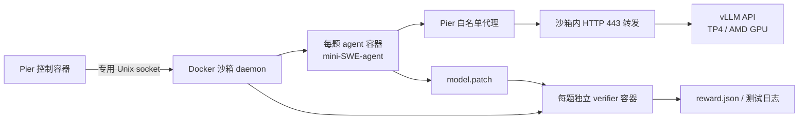

# MiniMax-M3.1-Flash DeepSWE 评估与复现

记录 MiniMax-M3.1-Flash Quark MXFP8 / MXFP4 的最新 DeepSWE 全量三轮结果，并提供固定版本的 Docker 环境、补丁、服务命令、`--n-attempts 3` 全量评估命令和只读诊断脚本。本文以 **2026-11-11 复核的 Pier + mini-SWE、并发 64、512K 上下文、64K 输出**实验为准。

## 最新结果

本次对比的模型如下。**baseline 指 Quark MXFP8 模型，不是 BF16 原始模型；对比模型为 Quark MXFP4。** 两者使用同一组评估参数，模型权重格式分别为 MXFP8、MXFP4，KV/indexer cache 均为 NVFP4。

| 对比角色 | 模型 / Hugging Face | 模型权重格式 |
|---|---|---|
| Baseline | [amd/MiniMax-M3.1-Flash-Quark-MXFP8](https://huggingface.co/amd/MiniMax-M3.1-Flash-Quark-MXFP8) | MXFP8 |
| MXFP4 对比模型 | [amd/MiniMax-M3.1-Flash-Quark-MXFP4](https://huggingface.co/amd/MiniMax-M3.1-Flash-Quark-MXFP4) | MXFP4 |

每种模型评估113题、重复3次，共339个trial。以原生verifier `reward == 1` 计为通过，分数为全部339次的平均通过率；OOM、超时和缺失reward计为未通过。

| 模型 | 轮次 | 通过 / 总数 | 分数 | 整轮耗时 | 截断响应数 | 有截断的题目轮次 |
|---|---|---:|---:|---:|---:|---:|
| MXFP8 | r1 | 87/113 | 76.99% | 3:20:58 | 0 | 0 |
| MXFP8 | r2 | 83/113 | 73.45% | 3:18:42 | 0 | 0 |
| MXFP8 | r3 | 79/113 | 69.91% | 3:42:57 | 5 | 1 |
| **MXFP8** | **合计 / 平均** | **249/339** | **73.45%** | **10:22:36** | **5** | **1** |
| MXFP4 | r1 | 76/113 | 67.26% | 2:46:55 | 1 | 1 |
| MXFP4 | r2 | 82/113 | 72.57% | 2:46:43 | 0 | 0 |
| MXFP4 | r3 | 78/113 | 69.03% | 2:51:38 | 8 | 1 |
| **MXFP4** | **合计 / 平均** | **236/339** | **69.62%** | **8:25:17** | **9** | **2** |

耗时为环境准备、agent解题及verifier测试的端到端时间。

| 正式三轮诊断，项目存在重叠 | MXFP8 | MXFP4 |
|---|---:|---:|
| Kea 任务容器 OOM 导致最终 agent 失败的题目轮次 | 3 | 3 |
| 整题 agent 超时（10800 秒） | 3 | 0 |
| verifier 超时（1800 秒） | 1 | 1 |
| RepeatedFormatError 退出的题目轮次 | 1 | 1 |
| 缺失 verifier reward 的题目轮次 | 1 | 1 |
| 30 秒工具命令超时次数 / 涉及题目轮次 | 637 / 200 | 583 / 201 |
| 上述工具超时题目轮次中最终通过 | 150/200 | 139/201 |
| 缺失轨迹 / patch 文件 | 0 / 0 | 0 / 0 |

逐题数据见 [CSV](data/trials.csv) 和 [JSON](data/latest-results.json)；版本与补丁指纹见 [versions.json](data/versions.json)。

## 环境方案：Dockerfile + Compose

采用三个组件，分开固定推理服务与评估框架依赖：



- [Dockerfile.pier](docker/Dockerfile.pier)：Python 3.12.15、固定 Pier commit、002/003 补丁，按上游 `uv.lock` 执行 `uv sync --frozen --no-dev`。Pier 安装在 `/opt/pier-venv`，不进入 vLLM Python 环境。
- [Dockerfile.vllm](docker/Dockerfile.vllm)：以固定ROCm镜像digest为基础，应用001的 `quark_moe.py` 运行时改动；校验补丁前后 SHA256，不整包升级 vLLM。
- [Dockerfile.sandbox](docker/Dockerfile.sandbox)：独立 Docker 28.3.2 daemon、持久化数据目录及模型 HTTP 转发；daemon 启用 `--init`，回收任务容器的孤儿子进程。
- [compose.yaml](compose.yaml)：配置 GPU、挂载、端口和独立网络。任务容器看不到控制器中的测试文件；verifier 在独立环境中运行。

构建与检查结果见 [验证记录](docs/validation.md)。

## 1. 准备机器、仓库和模型

需要Linux x86_64、4张支持当前MXFP8/AITER路径的AMD GPU（gfx950）、Docker Engine/Compose，以及可容纳并发64任务的CPU、内存和磁盘。GPU编号通过 `GPU_IDS` 配置。

模型权重另行下载或使用已有 checkpoint，不写入 Git。在 `.env` 的 `MODEL_PATH` 中填写自己的 checkpoint 绝对路径，例如 `/data/models/MiniMax-M3.1-Flash-Quark-MXFP8`。

从上述Hugging Face模型仓库准备checkpoint。以下命令下载MXFP8对应revision，需要模型仓库访问权限。

```bash
# 在已有 Hugging Face CLI 环境中运行；需要登录时用 hf auth login。
hf download amd/MiniMax-M3.1-Flash-Quark-MXFP8 \
  --revision refs/pr/1 \
  --local-dir /data/models/MiniMax-M3.1-Flash-Quark-MXFP8

git clone https://github.com/wangjiaxin99/minimax-m3.1-deepswe.git
cd minimax-m3.1-deepswe
cp .env.example .env
python3 - <<'PY'
from pathlib import Path
p = Path(".env")
p.write_text(p.read_text().replace("/absolute/path/to/minimax-m3.1-deepswe", str(Path.cwd())))
PY
```

编辑 `.env`：`REPO_DIR` 必须是本仓库的真实绝对路径，`MODEL_PATH` 必须存在，`SANDBOX_DATA_DIR` 使用专用大盘目录。不要指向其他实验的 Docker 数据根。配置 `GPU_IDS` 和未占用的 `SERVER_PORT`，检查控制网络、daemon 地址池及任务子网池不与已有网络冲突。

每组参数不变的三次 attempt 使用一个新的 `RUN_REL`，目录结构为：

```text
runs/vllm-run/<MMDD>_<NN>_<format>_deepswe_mini_c64_out64k_a3_nodelete/
  scripts/              # 保存本次实际使用的评估命令
  logs/server.log       # 新服务日志；复用服务时另记来源
  logs/eval_deepswe.log
  logs/deepswe/mini_<format>_attempts3/
  environment.json
  manifest.json
  summary.json
```

服务、镜像或参数变更时另建 run，避免覆盖旧结果；同一组配置重复三轮不新建三个 run。

## 2. 获取固定任务并构建环境

```bash
bash scripts/fetch_tasks.sh
docker compose --profile model config --quiet
docker compose build pier sandbox
docker compose --profile model build vllm
```

任务固定为 commit `0b9fabbb63b9104d678fe965e1632f2dd9eaa2ea`，脚本核对 113 个 `task.toml` 及干净工作树。构建需要网络访问 GitHub、PyPI 和镜像仓库。基础 ROCm 镜像无法拉取时，见 [基础镜像保留与迁移](docs/environment-and-patches.md)。

## 3. 启动 vLLM 和评估控制器

先核对 GPU/端口未被占用，再执行：

```bash
docker compose --profile model up -d vllm
docker compose up -d sandbox pier
docker compose logs --tail 50 vllm
docker compose exec pier docker info
docker compose exec pier python scripts/preflight.py --output state/preflight.json
```

preflight 检查 `/health`、模型 ID，并执行 100-token 固定问题冒烟；原始回答写入 `state/preflight.json` 并展示，不纳入评估得分。模型加载期间可能尚未健康，等待服务就绪后执行。

如果复用已有模型服务，省略启动 `vllm` 的命令，保证已有服务在 `SERVER_PORT` 可达，且模型 ID 与 `MODEL_PATH` 一致。参数必须使用下表配置，并在自己的run中记录服务配置和日志。

| 服务参数 | 配置 |
|---|---|
| TP / GPU | `--tensor-parallel-size 4`；由 `GPU_IDS` 选择4张卡 |
| 上下文 | `--max-model-len 524288` |
| KV / indexer cache | `nvfp4`，与 MXFP8/MXFP4 模型权重格式分别配置 |
| MoE | `--moe-backend aiter`，AITER MoE 开启 |
| MiniMax 输出解析 | `--tool-call-parser minimax_m3`、`--reasoning-parser minimax_m3`、自动 tool choice |
| 其他 | block size 128，关闭 hybrid KV cache manager，关闭 shared-expert fusion |

完整命令见 [server.sh](scripts/server.sh)。

## 4. 提前拉取任务镜像

```bash
docker compose exec pier python scripts/prefetch_images.py
docker compose exec pier docker system df
```

提前拉取题目声明的预构建镜像。首次运行还会构建mini-SWE、代理和verifier镜像；后续运行复用缓存。

任务 agent 的运行网络受 Pier 白名单控制，只开放配置的模型服务；verifier 按题目配置无网络运行。`http://...:443/v1` 使用 443 是为了符合 Pier 代理允许的端口，是普通 HTTP，非 TLS。

## 5. 单个 job 全量运行三次 attempt

```bash
docker compose exec -d pier bash scripts/run_eval.sh
```

后台程序在控制容器中运行，退出终端不会停止任务；停止/删除控制容器会中断。脚本遇到非零退出会停止运行，并保留已有结果供检查。不要对中断目录直接重跑覆盖，另设新的 `RUN_REL` 或按原生恢复流程处理并记录。

实时日志和进展：

```bash
docker compose exec pier bash -c 'tail -f "$REPO_DIR/$RUN_REL/logs/eval_deepswe.log"'
docker compose exec pier bash -c 'python scripts/summarize.py --manifest "$REPO_DIR/$RUN_REL/manifest.json" --allow-incomplete'
```

未完成的 job 打印的是固定339分母下的进度，不是最终准确率。全部完成后：

```bash
docker compose exec pier bash -c 'python scripts/summarize.py --manifest "$REPO_DIR/$RUN_REL/manifest.json" --output "$REPO_DIR/$RUN_REL/summary.json"'
```

完整原生评估命令在 [eval_deepswe.sh](scripts/eval_deepswe.sh)，配置如下：

| 参数 | 值及语义 |
|---|---|
| agent | mini-SWE-agent 2.4.5 |
| agent 内额外包 | `litellm[mcp]==1.108.3`、`mcp==2.3.0`；与 Pier 控制器依赖是两套环境 |
| 模型客户端 | `model_class=litellm_response`，原生 Responses API |
| 并发 | `--n-concurrent 64` |
| 正式 attempt | `--n-attempts 3`，113题×3次，共339个trial；共用并发64调度队列 |
| 框架重试 | `--max-retries 2`，处理可重试异常 |
| 输出 | `max_output_tokens=65536`，包含reasoning |
| 采样 | temperature 1、top_p 0.95、reasoning_effort max |
| cost limit | 0，关闭 agent 的费用预算限制；仍有时间/上下文限制 |
| agent setup multiplier | 5，setup预算 1800 秒 |
| agent/verifier multiplier | 均为 1，使用任务预算： 10800 / 1800 秒 |
| 清理 | `--no-delete`，结束时普通任务容器/网络会清理，镜像/卷保留 |

评估使用 `--n-attempts 3`、`--n-concurrent 64` 和 `--no-delete`。官方框架参考见 [参考来源](docs/references.md)。

## 6. verifier、轨迹和异常检查

每题运行顺序：准备基准仓库 → agent 看任务说明并多轮修改/测试 → agent 提交工作 → collect hook 提取 `model.patch` → 独立干净 verifier 应用代码补丁和测试 → 输出原生 reward。

```text
logs/deepswe/mini_<format>_attempts3/<trial>/
  result.json
  agent/mini-swe-agent.trajectory.json
  agent/mini-swe-agent.txt
  artifacts/model.patch
  verifier/reward.json
  verifier/test-stdout.txt
```

只读 [summarize.py](scripts/summarize.py) 按唯一 response ID 去重截断，区分工具命令超时与整题超时，检查缺失文件，并保持固定分母。它不执行 verifier、不改原始日志、不改变评分。空 patch 与缺失 patch 是两种情况。

通过轨迹检查agent执行，通过verifier日志检查测试失败原因。

## 7. 切换 MXFP4 或停止任务

MXFP8 的339个trial完成后，停止本仓库的模型服务：

```bash
docker compose --profile model stop vllm
```

将 `.env` 的 `MODEL_FORMAT` 改为 `mxfp4`、`MODEL_PATH` 改为 MXFP4 checkpoint，设置新的 `RUN_REL`，然后重新创建服务与控制器，让环境变量生效：

```bash
docker compose --profile model up -d --force-recreate vllm
docker compose up -d --force-recreate pier
docker compose exec pier python scripts/preflight.py --output state/preflight-mxfp4.json
docker compose exec -d pier bash scripts/run_eval.sh
```

沙箱 daemon 可保留以复用镜像缓存。中止评估可停止 `pier`，之后检查专用 daemon 中遗留的任务容器；不要把中断结果报为完成。整个部署停止使用 `docker compose --profile model down`；该命令保留 bind-mounted 镜像数据和运行日志。不要对宿主机共享 daemon 或其他实验执行全局 prune。

## 补丁与参考

| 补丁 | 修改对象 | 来源 / 作用 |
|---|---|---|
| [001](patches/001-vllm-quark-mxfp8.patch) | vLLM Quark MoE | [上游 PR #63125](https://github.com/vllm-project/vllm/pull/63125)，为了加载并推理 MXFP8 模型，支持 MXFP8 MoE / AITER |
| [002](patches/002-pier-provider-subnets.patch) | Pier agent setup / Codex 接入 | 本地基础设施适配；每 trial 分配独立子网，显式本地 API 不追加默认公共域名 |
| [003](patches/003-pier-mini-provider-allowlist.patch) | Pier 的 mini-SWE 接入 | 本地模型 API 白名单；未修改 mini-SWE-agent 包本身 |

任务、提示词和 verifier 无本地 patch。更多版本说明见 [环境与补丁](docs/environment-and-patches.md)，官方依据见 [参考来源](docs/references.md)。

## 仓库检查

```bash
python3 -m unittest discover -s tests -v
python3 scripts/check_published_data.py
for script in scripts/*.sh docker/*.sh; do bash -n "$script"; done
docker compose --profile model config --quiet
```

仓库代码按 Apache-2.0 提供；复制的上游补丁及其来源见 [THIRD_PARTY_NOTICES.md](THIRD_PARTY_NOTICES.md)。下载的 DeepSWE 任务、模型及第三方镜像分别适用自身许可证。
